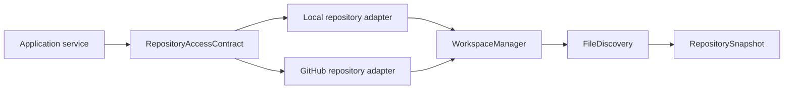

# Phase 4.6 Milestone 1: Repository Access

## Architecture overview



Milestone 1 provides repository retrieval, isolated workspaces, file metadata discovery, exclusions, limits, and security validation. It does not execute repository commands, add LLM calls, generate reports, or expose repository contents.

## Configuration

- `REPOSITORY_WORKSPACE_ROOT`
- `ALLOWED_LOCAL_REPOSITORY_ROOTS` (JSON list)
- `MAXIMUM_REPOSITORY_SIZE_BYTES`
- `MAXIMUM_REPOSITORY_FILE_SIZE_BYTES`
- `MAXIMUM_REPOSITORY_FILE_COUNT`
- `MAXIMUM_DIRECTORY_TRAVERSAL_DEPTH`
- `WORKSPACE_RETENTION_SECONDS`
- `GIT_EXECUTABLE_PATH`
- `GITHUB_ALLOWED_HOSTS` (JSON list)

An empty `ALLOWED_LOCAL_REPOSITORY_ROOTS` value permits any resolvable local directory. Production deployments should configure explicit roots.

## Local workflow

The local adapter validates directory existence, resolves the path, enforces allowed roots, rejects symlinks encountered during discovery/copy, copies into an isolated workspace, and discovers metadata.

```python
import asyncio
from app.repository.adapters.local_repository import LocalRepositoryAdapter

asyncio.run(LocalRepositoryAdapter().retrieve(r"C:\source\project"))
```

## GitHub workflow

The GitHub adapter accepts only approved HTTPS hosts, rejects credentials and private-network destinations, performs shallow cloning without repository hooks, captures `HEAD`, and discovers metadata.

```python
import asyncio
from app.repository.adapters.github_repository import GitHubRepositoryAdapter

asyncio.run(GitHubRepositoryAdapter().retrieve(
    "https://github.com/example/project.git",
    branch="main",
))
```

## Security and limitations

Repository code and scripts are never executed. Git hooks are disabled, credentials are not persisted, binary and sensitive files are excluded from hashes/content discovery, and workspace paths are not returned publicly. Public GitHub repositories are supported only.

## Tests

```powershell
.venv\Scripts\python.exe -m pytest tests/repository -q
.venv\Scripts\python.exe -m pytest -q
```
