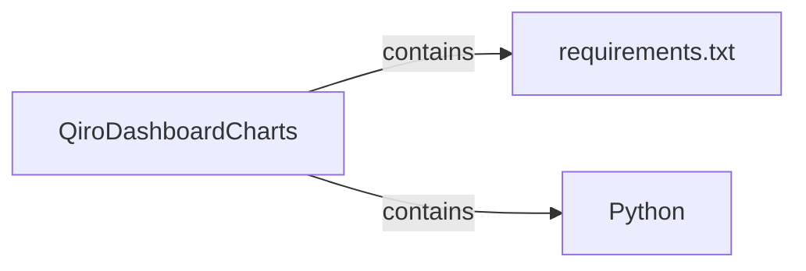
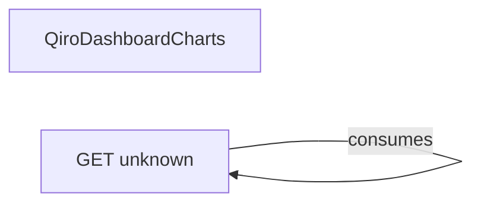
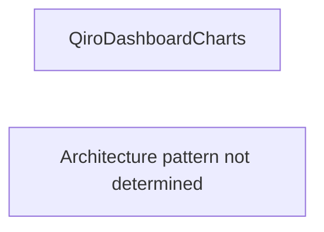

# Qiro Dashboard Architecture Assessment

- Repository: QiroDashboardCharts
- Source type: local
- Source reference: QiroDashboardCharts
- Generated: 2026-10-31T17:32:22.573466+00:00
- Report version: 1.0

## Table of Contents

- [Cover Page](#cover)
- [Executive Summary](#executive_summary)
- [Repository Overview](#repository_overview)
- [Existing Architecture](#existing_architecture)
- [Architecture Diagrams](#architecture_diagrams)
- [Technology Stack](#technology_stack)
- [Component and Dependency Analysis](#components_dependencies)
- [API Architecture](#api_architecture)
- [Database and Persistence Architecture](#database_architecture)
- [External Integrations](#external_integrations)
- [Architecture Findings and Observations](#architecture_findings)
- [Architecture Synthesis](#architecture_synthesis)
- [Synthesized Components and Responsibilities](#architecture_components)
- [Architecture Relationships](#architecture_relationships)
- [Architecture Data Flows](#architecture_data_flows)
- [External Systems and Integration Boundaries](#external_systems)
- [Architecture Review](#architecture_review)
- [Architecture Review Findings](#review_findings)
- [Positive Architecture Observations](#architecture_strengths)
- [Priority Recommendations](#recommendations)
- [Limitations and Unknowns](#limitations)
- [Evidence References](#evidence_references)
- [Appendix](#appendix)
- [Architecture Diagrams](#architecture-diagrams)

<a id="cover"></a>
## Cover Page

\# Qiro Dashboard Architecture Assessment

- Repository: QiroDashboardCharts
- Source type: local
- Source reference: QiroDashboardCharts
- Report version: 1.0

<a id="executive_summary"></a>
## Executive Summary

Analyzed QiroDashboardCharts using static repository evidence. Detected technologies: Python. Identified 1 project/package findings, 11 entry points, 1 API route/client findings, and 1 architectural pattern results.

Main technologies: Python.

Architecture synthesis: Static repository synthesis for QiroDashboardCharts identified 30 architectural components, 29 supported relationships, and 17 evidence-supported interactions. 0 relationship\(s\) are inferred rather than directly established. No runtime communication or deployment topology is claimed.

Architecture review outcome: needs_investigation. Reviewed 30 component\(s\), 29 relationship\(s\), 0 external system\(s\), and 17 data flow\(s\). Outcome: needs_investigation. Confirmed: 0; inferred: 1; investigation: 1.

Key architecture risks: low: Responsibility for requirements.txt may be unclear; low: Synthesis evidence has limitations.

Priority recommendations: Clarify the responsibility and ownership boundary of requirements.txt in the architecture documentation.; Review the synthesis limitations alongside repository evidence before making architectural decisions..

Important limitation: findings are based on static repository analysis; runtime behavior and deployment topology were not observed.

<a id="repository_overview"></a>
## Repository Overview

- Repository: QiroDashboardCharts
- Source type: local
- Source reference: QiroDashboardCharts

Technology stack: Python

Projects:
- requirements.txt \(python-project\)

Application entry points:
- Python application entry point: 'tmp/py_files/PyDataScript/prepare_ar_usd_data.py'
- Python application entry point: 'tmp/py_files/PyDataScript/prepare_banks_and_countries_usd_data.py'
- Python application entry point: 'tmp/py_files/PyDataScript/prepare_capex_usd_data.py'
- Python application entry point: 'tmp/py_files/PyDataScript/prepare_gsib_usd_data.py'
- Python application entry point: 'tmp/py_files/PyDataScript/prepare_nonreporters_usd_data.py'
- Python application entry point: 'tmp/py_files/PyDataScript/prepare_opex_usd_data.py'
- Python application entry point: 'tmp/py_files/PyDataScript/prepare_reportersandnonreporters_usd_data.py'
- Python application entry point: 'tmp/py_files/PyJsonScript/generate_ar_usd_json.py'
- Python application entry point: 'tmp/py_files/PyJsonScript/generate_capex_usd_json.py'
- Python application entry point: 'tmp/py_files/PyJsonScript/generate_nonreporters_usd_json.py'
- Python application entry point: 'tmp/py_files/PyJsonScript/generate_opex_usd_json.py'

Project structure: Identified 1 project/package manifests and 11 application entry points from static evidence.
Source directories: Not identified
Test directories: Not identified
Configuration locations: Not identified
Infrastructure locations: Not identified
Shared libraries: Not identified

Evidence: E0035, E0036, E0037, E0038, E0039, E0040, E0041, E0042, E0043, E0044, E0045, E0046

<a id="existing_architecture"></a>
## Existing Architecture

- No sufficiently supported architecture pattern was identified.

<a id="architecture_diagrams"></a>
## Architecture Diagrams

- System Context \('system_context'\)
- Component Architecture \('component_architecture'\)
- Project and Dependency Relationships \('project_dependencies'\)
- API Architecture \('api_architecture'\)
- Database and Persistence Architecture \('database_architecture'\)
- External Integration Architecture \('external_integrations'\)
- Architecture Patterns \('architecture_patterns'\)
- Unified Architecture \('unified_architecture'\)

<a id="technology_stack"></a>
## Technology Stack

- Python \(language, high\)

Evidence: E0001, E0002, E0003, E0004, E0005, E0006, E0007, E0008, E0009, E0010, E0011, E0012, E0013, E0014, E0015, E0016, E0017, E0018, E0019, E0020, E0021, E0022, E0023, E0024, E0025, E0026, E0027, E0028, E0029, E0030, E0031, E0032, E0033, E0034

<a id="components_dependencies"></a>
## Component and Dependency Analysis

- function_app.py --Python import--&gt; services/az_blob_services.py \(resolved: yes, confidence: high\)
- function_app.py --Python import--&gt; services/utils.py \(resolved: yes, confidence: high\)
- function_app.py --Python import--&gt; func_activities/chart_high_risk_countries.py \(resolved: yes, confidence: high\)
- function_app.py --Python import--&gt; func_activities/chart_banks_countries.py \(resolved: yes, confidence: high\)
- function_app.py --Python import--&gt; func_activities/chart_reporters_nonreporters.py \(resolved: yes, confidence: high\)
- function_app.py --Python import--&gt; func_activities/chart_nonreporters.py \(resolved: yes, confidence: high\)
- function_app.py --Python import--&gt; func_activities/chart_gsib.py \(resolved: yes, confidence: high\)
- function_app.py --Python import--&gt; func_activities/chart_capex.py \(resolved: yes, confidence: high\)
- function_app.py --Python import--&gt; func_activities/chart_opex.py \(resolved: yes, confidence: high\)
- function_app.py --Python import--&gt; func_activities/chart_ihcc.py \(resolved: yes, confidence: high\)
- function_app.py --Python import--&gt; func_activities/chart_ar.py \(resolved: yes, confidence: high\)
- func_activities/chart_ar.py --Python import--&gt; services/az_blob_services.py \(resolved: yes, confidence: high\)
- func_activities/chart_ar.py --Python import--&gt; services/sql_db_services.py \(resolved: yes, confidence: high\)
- func_activities/chart_banks_countries.py --Python import--&gt; services/az_blob_services.py \(resolved: yes, confidence: high\)
- func_activities/chart_banks_countries.py --Python import--&gt; services/sql_db_services.py \(resolved: yes, confidence: high\)
- func_activities/chart_capex.py --Python import--&gt; services/az_blob_services.py \(resolved: yes, confidence: high\)
- func_activities/chart_capex.py --Python import--&gt; services/sql_db_services.py \(resolved: yes, confidence: high\)
- func_activities/chart_gsib.py --Python import--&gt; services/az_blob_services.py \(resolved: yes, confidence: high\)
- func_activities/chart_gsib.py --Python import--&gt; services/sql_db_services.py \(resolved: yes, confidence: high\)
- func_activities/chart_high_risk_countries.py --Python import--&gt; services/az_blob_services.py \(resolved: yes, confidence: high\)
- func_activities/chart_high_risk_countries.py --Python import--&gt; services/sql_db_services.py \(resolved: yes, confidence: high\)
- func_activities/chart_ihcc.py --Python import--&gt; services/az_blob_services.py \(resolved: yes, confidence: high\)
- func_activities/chart_ihcc.py --Python import--&gt; services/sql_db_services.py \(resolved: yes, confidence: high\)
- func_activities/chart_nonreporters.py --Python import--&gt; services/az_blob_services.py \(resolved: yes, confidence: high\)
- func_activities/chart_nonreporters.py --Python import--&gt; services/sql_db_services.py \(resolved: yes, confidence: high\)
- func_activities/chart_opex.py --Python import--&gt; services/az_blob_services.py \(resolved: yes, confidence: high\)
- func_activities/chart_opex.py --Python import--&gt; services/sql_db_services.py \(resolved: yes, confidence: high\)
- func_activities/chart_reporters_nonreporters.py --Python import--&gt; services/az_blob_services.py \(resolved: yes, confidence: high\)
- func_activities/chart_reporters_nonreporters.py --Python import--&gt; services/sql_db_services.py \(resolved: yes, confidence: high\)
- services/az_blob_services.py --Python import--&gt; services/environment.py \(resolved: yes, confidence: high\)
- services/az_blob_services.py --Python import--&gt; services/utils.py \(resolved: yes, confidence: high\)
- services/environment.py --Python import--&gt; services/keyvaultsecrets.py \(resolved: yes, confidence: high\)
- services/sql_db_services.py --Python import--&gt; services/environment.py \(resolved: yes, confidence: high\)

Evidence: E0047, E0048, E0049, E0050, E0051, E0052, E0053, E0054, E0055, E0056, E0057, E0058, E0059, E0060, E0061, E0062, E0063, E0064, E0065, E0066, E0067, E0068, E0069, E0070, E0071, E0072, E0073, E0074, E0075, E0076, E0077, E0078, E0079

<a id="api_architecture"></a>
## API Architecture

E
x
p
o
s
e
d
 
A
P
I
s
:


C
o
n
s
u
m
e
d
 
A
P
I
s
:


-
 
G
E
T
 
u
n
k
n
o
w
n
 
\(
H
T
T
P
 
c
l
i
e
n
t
\)

Evidence: E0080

<a id="database_architecture"></a>
## Database and Persistence Architecture

- Database configuration: configuration key in 'local.settings.json': Configuration key: SqlConnectionString \(medium\)
- Repository persistence abstraction: Persistence repository abstraction in 'func_activities/chart_ar.py': Persistence repository abstraction \(high\)
- Repository persistence abstraction: Persistence repository abstraction in 'func_activities/chart_banks_countries.py': Persistence repository abstraction \(high\)
- Repository persistence abstraction: Persistence repository abstraction in 'func_activities/chart_capex.py': Persistence repository abstraction \(high\)
- Repository persistence abstraction: Persistence repository abstraction in 'func_activities/chart_gsib.py': Persistence repository abstraction \(high\)
- Repository persistence abstraction: Persistence repository abstraction in 'func_activities/chart_high_risk_countries.py': Persistence repository abstraction \(high\)
- Repository persistence abstraction: Persistence repository abstraction in 'func_activities/chart_ihcc.py': Persistence repository abstraction \(high\)
- Repository persistence abstraction: Persistence repository abstraction in 'func_activities/chart_nonreporters.py': Persistence repository abstraction \(high\)
- Repository persistence abstraction: Persistence repository abstraction in 'func_activities/chart_opex.py': Persistence repository abstraction \(high\)
- Repository persistence abstraction: Persistence repository abstraction in 'func_activities/chart_reporters_nonreporters.py': Persistence repository abstraction \(high\)
- Database configuration: configuration key in 'payload/Sample_Payload.txt': Configuration key: SqlConnectionString \(medium\)
- Repository persistence abstraction: Persistence repository abstraction in 'services/az_blob_services.py': Persistence repository abstraction \(high\)
- Repository persistence abstraction: Persistence repository abstraction in 'services/environment.py': Persistence repository abstraction \(high\)
- Repository persistence abstraction: Persistence repository abstraction in 'services/sql_db_services.py': Persistence repository abstraction \(high\)
- Repository persistence abstraction: Persistence repository abstraction in 'services/utils.py': Persistence repository abstraction \(high\)
- Repository persistence abstraction: Persistence repository abstraction in 'temp/poc.ipynb': Persistence repository abstraction \(high\)
- Repository persistence abstraction: Persistence repository abstraction in 'tmp/py_files/PyDataScript/prepare_ar_usd_data.py': Persistence repository abstraction \(high\)
- Repository persistence abstraction: Persistence repository abstraction in 'tmp/py_files/PyDataScript/prepare_banks_and_countries_usd_data.py': Persistence repository abstraction \(high\)
- Repository persistence abstraction: Persistence repository abstraction in 'tmp/py_files/PyDataScript/prepare_capex_usd_data.py': Persistence repository abstraction \(high\)
- Repository persistence abstraction: Persistence repository abstraction in 'tmp/py_files/PyDataScript/prepare_high_risk_countries_usd_data.py': Persistence repository abstraction \(high\)
- Repository persistence abstraction: Persistence repository abstraction in 'tmp/py_files/PyDataScript/prepare_opex_usd_data.py': Persistence repository abstraction \(high\)
- Repository persistence abstraction: Persistence repository abstraction in 'tmp/py_files/PyJsonScript/generate_banks_and_countries_usd_json.py': Persistence repository abstraction \(high\)
- Repository persistence abstraction: Persistence repository abstraction in 'tmp/py_files/PyJsonScript/generate_capex_usd_json.py': Persistence repository abstraction \(high\)
- Repository persistence abstraction: Persistence repository abstraction in 'tmp/py_files/PyJsonScript/generate_opex_usd_json.py': Persistence repository abstraction \(high\)

Evidence: E0081, E0082, E0083, E0084, E0085, E0086, E0087, E0088, E0089, E0090, E0091, E0092, E0093, E0094, E0095, E0096, E0097, E0098, E0099, E0100, E0101, E0102, E0103, E0104

<a id="external_integrations"></a>
## External Integrations

- Object/file storage: storage, status confirmed, source '.gitignore': Object/file storage API or package usage is present in repository evidence., confidence: high
- Object/file storage: storage, status confirmed, source 'local.settings.json': Object/file storage API or package usage is present in repository evidence., confidence: high
- Object/file storage: storage, status confirmed, source 'requirements.txt': Object/file storage API or package usage is present in repository evidence., confidence: high
- Object/file storage: storage, status confirmed, source 'payload/Sample_Payload.txt': Object/file storage API or package usage is present in repository evidence., confidence: high
- Object/file storage: storage, status confirmed, source 'services/az_blob_services.py': Object/file storage API or package usage is present in repository evidence., confidence: high
- Cloud SDK: cloud, status confirmed, source 'services/environment.py': Cloud SDK API or package usage is present in repository evidence., confidence: high
- Authentication provider: authentication, status confirmed, source 'services/environment.py': Authentication provider API or package usage is present in repository evidence., confidence: high
- Object/file storage: storage, status confirmed, source 'services/environment.py': Object/file storage API or package usage is present in repository evidence., confidence: high
- Object/file storage: storage, status confirmed, source 'services/keyvaultsecrets.py': Object/file storage API or package usage is present in repository evidence., confidence: high
- REST/HTTP client: HTTP, status confirmed, source 'services/sql_db_services.py': REST/HTTP client API or package usage is present in repository evidence., confidence: high
- Message broker: messaging, status confirmed, source 'temp/poc.ipynb': Message broker API or package usage is present in repository evidence., confidence: high
- Cloud SDK: cloud, status confirmed, source 'temp/poc.ipynb': Cloud SDK API or package usage is present in repository evidence., confidence: high
- Object/file storage: storage, status confirmed, source 'temp/poc.ipynb': Object/file storage API or package usage is present in repository evidence., confidence: high

Evidence: E0105, E0106, E0107, E0108, E0109, E0110, E0111, E0112, E0113, E0114, E0115, E0116, E0117

<a id="architecture_findings"></a>
## Architecture Findings and Observations

Analyzed QiroDashboardCharts using static repository evidence. Detected technologies: Python. Identified 1 project/package findings, 11 entry points, 1 API route/client findings, and 1 architectural pattern results.

No unsupported quality, vulnerability, or security conclusions are included.

<a id="architecture_synthesis"></a>
## Architecture Synthesis

Static repository synthesis for QiroDashboardCharts identified 30 architectural components, 29 supported relationships, and 17 evidence-supported interactions. 0 relationship\(s\) are inferred rather than directly established. No runtime communication or deployment topology is claimed.

<a id="architecture_components"></a>
## Synthesized Components and Responsibilities

- QiroDashboardCharts \[repository\]: Repository application boundary represented by static analysis findings. \(confidence: high\)
- requirements.txt \[project\]: Project/package identified from requirements.txt. \(confidence: medium\)
- Python application entry point entry point \[entry_point\]: Application entry point from tmp/py_files/PyDataScript/prepare_ar_usd_data.py \(confidence: high\)
- Python application entry point entry point \[entry_point\]: Application entry point from tmp/py_files/PyDataScript/prepare_banks_and_countries_usd_data.py \(confidence: high\)
- Python application entry point entry point \[entry_point\]: Application entry point from tmp/py_files/PyDataScript/prepare_capex_usd_data.py \(confidence: high\)
- Python application entry point entry point \[entry_point\]: Application entry point from tmp/py_files/PyDataScript/prepare_gsib_usd_data.py \(confidence: high\)
- Python application entry point entry point \[entry_point\]: Application entry point from tmp/py_files/PyDataScript/prepare_nonreporters_usd_data.py \(confidence: high\)
- Python application entry point entry point \[entry_point\]: Application entry point from tmp/py_files/PyDataScript/prepare_opex_usd_data.py \(confidence: high\)
- Python application entry point entry point \[entry_point\]: Application entry point from tmp/py_files/PyDataScript/prepare_reportersandnonreporters_usd_data.py \(confidence: high\)
- Python application entry point entry point \[entry_point\]: Application entry point from tmp/py_files/PyJsonScript/generate_ar_usd_json.py \(confidence: high\)
- Python application entry point entry point \[entry_point\]: Application entry point from tmp/py_files/PyJsonScript/generate_capex_usd_json.py \(confidence: high\)
- Python application entry point entry point \[entry_point\]: Application entry point from tmp/py_files/PyJsonScript/generate_nonreporters_usd_json.py \(confidence: high\)
- Python application entry point entry point \[entry_point\]: Application entry point from tmp/py_files/PyJsonScript/generate_opex_usd_json.py \(confidence: high\)
- Database configuration \[persistence\]: Configuration key: SqlConnectionString \(confidence: medium\)
- Repository persistence abstraction \[persistence\]: Persistence repository abstraction \(confidence: high\)
- Repository persistence abstraction \[persistence\]: Persistence repository abstraction \(confidence: high\)
- Repository persistence abstraction \[persistence\]: Persistence repository abstraction \(confidence: high\)
- Repository persistence abstraction \[persistence\]: Persistence repository abstraction \(confidence: high\)
- Repository persistence abstraction \[persistence\]: Persistence repository abstraction \(confidence: high\)
- Repository persistence abstraction \[persistence\]: Persistence repository abstraction \(confidence: high\)
- Repository persistence abstraction \[persistence\]: Persistence repository abstraction \(confidence: high\)
- Repository persistence abstraction \[persistence\]: Persistence repository abstraction \(confidence: high\)
- Repository persistence abstraction \[persistence\]: Persistence repository abstraction \(confidence: high\)
- Database configuration \[persistence\]: Configuration key: SqlConnectionString \(confidence: medium\)
- Repository persistence abstraction \[persistence\]: Persistence repository abstraction \(confidence: high\)
- Repository persistence abstraction \[persistence\]: Persistence repository abstraction \(confidence: high\)
- Repository persistence abstraction \[persistence\]: Persistence repository abstraction \(confidence: high\)
- Repository persistence abstraction \[persistence\]: Persistence repository abstraction \(confidence: high\)
- Repository persistence abstraction \[persistence\]: Persistence repository abstraction \(confidence: high\)
- Repository persistence abstraction \[persistence\]: Persistence repository abstraction \(confidence: high\)

Evidence: E0002, E0035, E0107, E0035, E0036, E0037, E0038, E0039, E0040, E0041, E0042, E0043, E0044, E0045, E0046, E0081, E0082, E0083, E0084, E0085, E0086, E0087, E0088, E0089, E0090, E0091, E0092, E0093, E0094, E0095, E0096, E0097

<a id="architecture_relationships"></a>
## Architecture Relationships

- repository_8a5d4d19 --contains--&gt; project_0cdb17d3: The repository contains this project/package. \[confirmed\] \(confidence: medium\)
- repository_8a5d4d19 --hosts--&gt; entrypoint_1f607069: Static evidence identifies this as an application entry point. \[confirmed\] \(confidence: high\)
- repository_8a5d4d19 --hosts--&gt; entrypoint_6da6b453: Static evidence identifies this as an application entry point. \[confirmed\] \(confidence: high\)
- repository_8a5d4d19 --hosts--&gt; entrypoint_76ae67b1: Static evidence identifies this as an application entry point. \[confirmed\] \(confidence: high\)
- repository_8a5d4d19 --hosts--&gt; entrypoint_ac7995e4: Static evidence identifies this as an application entry point. \[confirmed\] \(confidence: high\)
- repository_8a5d4d19 --hosts--&gt; entrypoint_bef9cb31: Static evidence identifies this as an application entry point. \[confirmed\] \(confidence: high\)
- repository_8a5d4d19 --hosts--&gt; entrypoint_f5a67352: Static evidence identifies this as an application entry point. \[confirmed\] \(confidence: high\)
- repository_8a5d4d19 --hosts--&gt; entrypoint_9cb7fc4d: Static evidence identifies this as an application entry point. \[confirmed\] \(confidence: high\)
- repository_8a5d4d19 --hosts--&gt; entrypoint_e82262bc: Static evidence identifies this as an application entry point. \[confirmed\] \(confidence: high\)
- repository_8a5d4d19 --hosts--&gt; entrypoint_a9bce482: Static evidence identifies this as an application entry point. \[confirmed\] \(confidence: high\)
- repository_8a5d4d19 --hosts--&gt; entrypoint_ce6c5f44: Static evidence identifies this as an application entry point. \[confirmed\] \(confidence: high\)
- repository_8a5d4d19 --hosts--&gt; entrypoint_e5f970df: Static evidence identifies this as an application entry point. \[confirmed\] \(confidence: high\)
- repository_8a5d4d19 --uses_persistence--&gt; database_72b041a4: Static repository evidence configures or references persistence. \[confirmed\] \(confidence: medium\)
- repository_8a5d4d19 --uses_persistence--&gt; database_96e03f1f: Static repository evidence configures or references persistence. \[confirmed\] \(confidence: high\)
- repository_8a5d4d19 --uses_persistence--&gt; database_b5b79290: Static repository evidence configures or references persistence. \[confirmed\] \(confidence: high\)
- repository_8a5d4d19 --uses_persistence--&gt; database_1813db91: Static repository evidence configures or references persistence. \[confirmed\] \(confidence: high\)
- repository_8a5d4d19 --uses_persistence--&gt; database_6d272935: Static repository evidence configures or references persistence. \[confirmed\] \(confidence: high\)
- repository_8a5d4d19 --uses_persistence--&gt; database_981a826b: Static repository evidence configures or references persistence. \[confirmed\] \(confidence: high\)
- repository_8a5d4d19 --uses_persistence--&gt; database_9c908f82: Static repository evidence configures or references persistence. \[confirmed\] \(confidence: high\)
- repository_8a5d4d19 --uses_persistence--&gt; database_6a8fc845: Static repository evidence configures or references persistence. \[confirmed\] \(confidence: high\)
- repository_8a5d4d19 --uses_persistence--&gt; database_a11f0215: Static repository evidence configures or references persistence. \[confirmed\] \(confidence: high\)
- repository_8a5d4d19 --uses_persistence--&gt; database_35a4d944: Static repository evidence configures or references persistence. \[confirmed\] \(confidence: high\)
- repository_8a5d4d19 --uses_persistence--&gt; database_959d3134: Static repository evidence configures or references persistence. \[confirmed\] \(confidence: medium\)
- repository_8a5d4d19 --uses_persistence--&gt; database_5f8fc4e8: Static repository evidence configures or references persistence. \[confirmed\] \(confidence: high\)
- repository_8a5d4d19 --uses_persistence--&gt; database_1cb4880f: Static repository evidence configures or references persistence. \[confirmed\] \(confidence: high\)
- repository_8a5d4d19 --uses_persistence--&gt; database_06c3d1d4: Static repository evidence configures or references persistence. \[confirmed\] \(confidence: high\)
- repository_8a5d4d19 --uses_persistence--&gt; database_4ad19840: Static repository evidence configures or references persistence. \[confirmed\] \(confidence: high\)
- repository_8a5d4d19 --uses_persistence--&gt; database_813098af: Static repository evidence configures or references persistence. \[confirmed\] \(confidence: high\)
- repository_8a5d4d19 --uses_persistence--&gt; database_37917c84: Static repository evidence configures or references persistence. \[confirmed\] \(confidence: high\)

Evidence: E0035, E0036, E0037, E0038, E0039, E0040, E0041, E0042, E0043, E0044, E0045, E0046, E0081, E0082, E0083, E0084, E0085, E0086, E0087, E0088, E0089, E0090, E0091, E0092, E0093, E0094, E0095, E0096, E0097

<a id="architecture_data_flows"></a>
## Architecture Data Flows

- repository_8a5d4d19 -&gt; database_72b041a4: Static evidence indicates a persistence interaction; runtime data movement is not established. \(persistence access, inferred\), confidence: medium
- repository_8a5d4d19 -&gt; database_96e03f1f: Static evidence indicates a persistence interaction; runtime data movement is not established. \(persistence access, inferred\), confidence: high
- repository_8a5d4d19 -&gt; database_b5b79290: Static evidence indicates a persistence interaction; runtime data movement is not established. \(persistence access, inferred\), confidence: high
- repository_8a5d4d19 -&gt; database_1813db91: Static evidence indicates a persistence interaction; runtime data movement is not established. \(persistence access, inferred\), confidence: high
- repository_8a5d4d19 -&gt; database_6d272935: Static evidence indicates a persistence interaction; runtime data movement is not established. \(persistence access, inferred\), confidence: high
- repository_8a5d4d19 -&gt; database_981a826b: Static evidence indicates a persistence interaction; runtime data movement is not established. \(persistence access, inferred\), confidence: high
- repository_8a5d4d19 -&gt; database_9c908f82: Static evidence indicates a persistence interaction; runtime data movement is not established. \(persistence access, inferred\), confidence: high
- repository_8a5d4d19 -&gt; database_6a8fc845: Static evidence indicates a persistence interaction; runtime data movement is not established. \(persistence access, inferred\), confidence: high
- repository_8a5d4d19 -&gt; database_a11f0215: Static evidence indicates a persistence interaction; runtime data movement is not established. \(persistence access, inferred\), confidence: high
- repository_8a5d4d19 -&gt; database_35a4d944: Static evidence indicates a persistence interaction; runtime data movement is not established. \(persistence access, inferred\), confidence: high
- repository_8a5d4d19 -&gt; database_959d3134: Static evidence indicates a persistence interaction; runtime data movement is not established. \(persistence access, inferred\), confidence: medium
- repository_8a5d4d19 -&gt; database_5f8fc4e8: Static evidence indicates a persistence interaction; runtime data movement is not established. \(persistence access, inferred\), confidence: high
- repository_8a5d4d19 -&gt; database_1cb4880f: Static evidence indicates a persistence interaction; runtime data movement is not established. \(persistence access, inferred\), confidence: high
- repository_8a5d4d19 -&gt; database_06c3d1d4: Static evidence indicates a persistence interaction; runtime data movement is not established. \(persistence access, inferred\), confidence: high
- repository_8a5d4d19 -&gt; database_4ad19840: Static evidence indicates a persistence interaction; runtime data movement is not established. \(persistence access, inferred\), confidence: high
- repository_8a5d4d19 -&gt; database_813098af: Static evidence indicates a persistence interaction; runtime data movement is not established. \(persistence access, inferred\), confidence: high
- repository_8a5d4d19 -&gt; database_37917c84: Static evidence indicates a persistence interaction; runtime data movement is not established. \(persistence access, inferred\), confidence: high

Evidence: E0081, E0082, E0083, E0084, E0085, E0086, E0087, E0088, E0089, E0090, E0091, E0092, E0093, E0094, E0095, E0096, E0097

<a id="external_systems"></a>
## External Systems and Integration Boundaries

- No external systems were synthesized.

<a id="architecture_review"></a>
## Architecture Review

Overall outcome: needs_investigation

Reviewed 30 component\(s\), 29 relationship\(s\), 0 external system\(s\), and 17 data flow\(s\). Outcome: needs_investigation. Confirmed: 0; inferred: 1; investigation: 1.

<a id="review_findings"></a>
## Architecture Review Findings

- \[LOW\] Responsibility for requirements.txt may be unclear \(architecture_structure; inferred\): The synthesized component description is generic or insufficient to explain its responsibility.
  Affected components: project_0cdb17d3
  Related relationships: None
  Related data flows: None
  Recommendation: Clarify the responsibility and ownership boundary of requirements.txt in the architecture documentation.
  Confidence: medium

- \[LOW\] Synthesis evidence has limitations \(evidence_quality; needs_investigation\): The synthesis reports warnings or limitations, so review conclusions should be treated as partial static evidence.
  Affected components: Not specified
  Related relationships: None
  Related data flows: None
  Recommendation: Review the synthesis limitations alongside repository evidence before making architectural decisions.
  Confidence: medium

Evidence: E0035

<a id="architecture_strengths"></a>
## Positive Architecture Observations

- Architecture components are traceable to repository evidence: 30 synthesized component\(s\) include preserved evidence references. \(components: repository_8a5d4d19, project_0cdb17d3, entrypoint_1f607069, entrypoint_6da6b453, entrypoint_76ae67b1, entrypoint_ac7995e4, entrypoint_bef9cb31, entrypoint_f5a67352, entrypoint_9cb7fc4d, entrypoint_e82262bc, entrypoint_a9bce482, entrypoint_ce6c5f44, entrypoint_e5f970df, database_72b041a4, database_96e03f1f, database_b5b79290, database_1813db91, database_6d272935, database_981a826b, database_9c908f82, database_6a8fc845, database_a11f0215, database_35a4d944, database_959d3134, database_5f8fc4e8, database_1cb4880f, database_06c3d1d4, database_4ad19840, database_813098af, database_37917c84\) \(confidence: high\)
- Confirmed relationships are evidence-backed: 29 confirmed relationship\(s\) have supporting evidence references. \(components: Not specified\) \(confidence: high\)
- Synthesis preserves traceable data flows: 17 data-flow path\(s\) are represented with source, target, and evidence metadata. \(components: Not specified\) \(confidence: medium\)

Evidence: E0002, E0035, E0036, E0037, E0038, E0039, E0040, E0041, E0042, E0043, E0044, E0045, E0046, E0081, E0082, E0083, E0084, E0085, E0086, E0087, E0088, E0089, E0090, E0091, E0092, E0093, E0094, E0095, E0096, E0097, E0035, E0036, E0037, E0038, E0039, E0040, E0041, E0042, E0043, E0044, E0045, E0046, E0081, E0082, E0083, E0084, E0085, E0086, E0087, E0088, E0089, E0090, E0091, E0092, E0093, E0094, E0095, E0096, E0097, E0081, E0082, E0083, E0084, E0085, E0086, E0087, E0088, E0089, E0090, E0091, E0092, E0093, E0094, E0095, E0096, E0097

<a id="recommendations"></a>
## Priority Recommendations

- \[MEDIUM priority\] Clarify the responsibility and ownership boundary of requirements.txt in the architecture documentation.
  Benefits: Makes change impact and ownership easier to reason about.
  Trade-offs: Documentation detail may need validation against source behavior.
  Implementation: Not specified

- \[MEDIUM priority\] Review the synthesis limitations alongside repository evidence before making architectural decisions.
  Benefits: Keeps evidence gaps visible and prevents unsupported conclusions.
  Trade-offs: Some questions cannot be resolved without additional repository or runtime context.
  Implementation: Not specified

Evidence: E0035

<a id="limitations"></a>
## Limitations and Unknowns

- Static analysis only; runtime behavior and deployment topology were not observed.
- Dependency relationships and framework configuration are limited to evidence in discovered text files.
- Diagram system_context failed structural validation: Diagram exceeds the 30-node complexity limit.; Diagram exceeds the 30-edge complexity limit.
- Diagram component_architecture rendered as Mermaid source only; renderer unavailable.
- Diagram project_dependencies failed structural validation: Diagram exceeds the 30-node complexity limit.
- Diagram api_architecture rendered as Mermaid source only; renderer unavailable.
- Diagram database_architecture rendered as Mermaid source only; renderer unavailable.
- Diagram external_integrations rendered as Mermaid source only; renderer unavailable.
- Diagram exceeds the 30-node complexity limit.
- Diagram exceeds the 30-edge complexity limit.
- Diagram limited to the first 30 dependency findings.
- No sufficiently supported architecture pattern was identified.
- Architecture synthesis components limited to 30 items.
- Architecture synthesis relationships limited to 30 items.
- Architecture synthesis data flows limited to 30 items.
- Diagram exceeds the 30-node complexity limit.
- Diagram exceeds the 30-edge complexity limit.
- Diagram limited to the first 30 dependency findings.
- Diagram exceeds the 30-node complexity limit.
- No sufficiently supported architecture pattern was identified.

<a id="evidence_references"></a>
## Evidence References

- E0001: 'function_app.py' \(technology\) - Python evidence found.
- E0002: 'requirements.txt' \(technology\) - Python evidence found.
- E0003: 'func_activities/chart_ar.py' \(technology\) - Python evidence found.
- E0004: 'func_activities/chart_banks_countries.py' \(technology\) - Python evidence found.
- E0005: 'func_activities/chart_capex.py' \(technology\) - Python evidence found.
- E0006: 'func_activities/chart_gsib.py' \(technology\) - Python evidence found.
- E0007: 'func_activities/chart_high_risk_countries.py' \(technology\) - Python evidence found.
- E0008: 'func_activities/chart_ihcc.py' \(technology\) - Python evidence found.
- E0009: 'func_activities/chart_nonreporters.py' \(technology\) - Python evidence found.
- E0010: 'func_activities/chart_opex.py' \(technology\) - Python evidence found.
- E0011: 'func_activities/chart_reporters_nonreporters.py' \(technology\) - Python evidence found.
- E0012: 'services/az_blob_services.py' \(technology\) - Python evidence found.
- E0013: 'services/environment.py' \(technology\) - Python evidence found.
- E0014: 'services/keyvaultsecrets.py' \(technology\) - Python evidence found.
- E0015: 'services/sql_db_services.py' \(technology\) - Python evidence found.
- E0016: 'services/utils.py' \(technology\) - Python evidence found.
- E0017: 'tmp/py_files/PyDataScript/prepare_ar_usd_data.py' \(technology\) - Python evidence found.
- E0018: 'tmp/py_files/PyDataScript/prepare_banks_and_countries_usd_data.py' \(technology\) - Python evidence found.
- E0019: 'tmp/py_files/PyDataScript/prepare_capex_usd_data.py' \(technology\) - Python evidence found.
- E0020: 'tmp/py_files/PyDataScript/prepare_gsib_usd_data.py' \(technology\) - Python evidence found.
- E0021: 'tmp/py_files/PyDataScript/prepare_high_risk_countries_usd_data.py' \(technology\) - Python evidence found.
- E0022: 'tmp/py_files/PyDataScript/prepare_ihcc_usd_data.py' \(technology\) - Python evidence found.
- E0023: 'tmp/py_files/PyDataScript/prepare_nonreporters_usd_data.py' \(technology\) - Python evidence found.
- E0024: 'tmp/py_files/PyDataScript/prepare_opex_usd_data.py' \(technology\) - Python evidence found.
- E0025: 'tmp/py_files/PyDataScript/prepare_reportersandnonreporters_usd_data.py' \(technology\) - Python evidence found.
- E0026: 'tmp/py_files/PyJsonScript/generate_ar_usd_json.py' \(technology\) - Python evidence found.
- E0027: 'tmp/py_files/PyJsonScript/generate_banks_and_countries_usd_json.py' \(technology\) - Python evidence found.
- E0028: 'tmp/py_files/PyJsonScript/generate_capex_usd_json.py' \(technology\) - Python evidence found.
- E0029: 'tmp/py_files/PyJsonScript/generate_gsib_usd_json.py' \(technology\) - Python evidence found.
- E0030: 'tmp/py_files/PyJsonScript/generate_high_risk_countries_usd_json.py' \(technology\) - Python evidence found.
- E0031: 'tmp/py_files/PyJsonScript/generate_ihcc_usd_json.py' \(technology\) - Python evidence found.
- E0032: 'tmp/py_files/PyJsonScript/generate_nonreporters_usd_json.py' \(technology\) - Python evidence found.
- E0033: 'tmp/py_files/PyJsonScript/generate_opex_usd_json.py' \(technology\) - Python evidence found.
- E0034: 'tmp/py_files/PyJsonScript/generate_reportersandnonreporters_usd_json.py' \(technology\) - Python evidence found.
- E0035: 'requirements.txt' \(project\) - Python project manifest or dependency configuration discovered.
- E0036: 'tmp/py_files/PyDataScript/prepare_ar_usd_data.py' \(entry_point\) - Python application entry-point or application object found.
- E0037: 'tmp/py_files/PyDataScript/prepare_banks_and_countries_usd_data.py' \(entry_point\) - Python application entry-point or application object found.
- E0038: 'tmp/py_files/PyDataScript/prepare_capex_usd_data.py' \(entry_point\) - Python application entry-point or application object found.
- E0039: 'tmp/py_files/PyDataScript/prepare_gsib_usd_data.py' \(entry_point\) - Python application entry-point or application object found.
- E0040: 'tmp/py_files/PyDataScript/prepare_nonreporters_usd_data.py' \(entry_point\) - Python application entry-point or application object found.
- E0041: 'tmp/py_files/PyDataScript/prepare_opex_usd_data.py' \(entry_point\) - Python application entry-point or application object found.
- E0042: 'tmp/py_files/PyDataScript/prepare_reportersandnonreporters_usd_data.py' \(entry_point\) - Python application entry-point or application object found.
- E0043: 'tmp/py_files/PyJsonScript/generate_ar_usd_json.py' \(entry_point\) - Python application entry-point or application object found.
- E0044: 'tmp/py_files/PyJsonScript/generate_capex_usd_json.py' \(entry_point\) - Python application entry-point or application object found.
- E0045: 'tmp/py_files/PyJsonScript/generate_nonreporters_usd_json.py' \(entry_point\) - Python application entry-point or application object found.
- E0046: 'tmp/py_files/PyJsonScript/generate_opex_usd_json.py' \(entry_point\) - Python application entry-point or application object found.
- E0047: 'function_app.py' \(dependency\) - Internal Python import of services.az_blob_services.
- E0048: 'function_app.py' \(dependency\) - Internal Python import of services.utils.
- E0049: 'function_app.py' \(dependency\) - Internal Python import of func_activities.chart_high_risk_countries.
- E0050: 'function_app.py' \(dependency\) - Internal Python import of func_activities.chart_banks_countries.
- E0051: 'function_app.py' \(dependency\) - Internal Python import of func_activities.chart_reporters_nonreporters.
- E0052: 'function_app.py' \(dependency\) - Internal Python import of func_activities.chart_nonreporters.
- E0053: 'function_app.py' \(dependency\) - Internal Python import of func_activities.chart_gsib.
- E0054: 'function_app.py' \(dependency\) - Internal Python import of func_activities.chart_capex.
- E0055: 'function_app.py' \(dependency\) - Internal Python import of func_activities.chart_opex.
- E0056: 'function_app.py' \(dependency\) - Internal Python import of func_activities.chart_ihcc.
- E0057: 'function_app.py' \(dependency\) - Internal Python import of func_activities.chart_ar.
- E0058: 'func_activities/chart_ar.py' \(dependency\) - Internal Python import of services.az_blob_services.
- E0059: 'func_activities/chart_ar.py' \(dependency\) - Internal Python import of services.sql_db_services.
- E0060: 'func_activities/chart_banks_countries.py' \(dependency\) - Internal Python import of services.az_blob_services.
- E0061: 'func_activities/chart_banks_countries.py' \(dependency\) - Internal Python import of services.sql_db_services.
- E0062: 'func_activities/chart_capex.py' \(dependency\) - Internal Python import of services.az_blob_services.
- E0063: 'func_activities/chart_capex.py' \(dependency\) - Internal Python import of services.sql_db_services.
- E0064: 'func_activities/chart_gsib.py' \(dependency\) - Internal Python import of services.az_blob_services.
- E0065: 'func_activities/chart_gsib.py' \(dependency\) - Internal Python import of services.sql_db_services.
- E0066: 'func_activities/chart_high_risk_countries.py' \(dependency\) - Internal Python import of services.az_blob_services.
- E0067: 'func_activities/chart_high_risk_countries.py' \(dependency\) - Internal Python import of services.sql_db_services.
- E0068: 'func_activities/chart_ihcc.py' \(dependency\) - Internal Python import of services.az_blob_services.
- E0069: 'func_activities/chart_ihcc.py' \(dependency\) - Internal Python import of services.sql_db_services.
- E0070: 'func_activities/chart_nonreporters.py' \(dependency\) - Internal Python import of services.az_blob_services.
- E0071: 'func_activities/chart_nonreporters.py' \(dependency\) - Internal Python import of services.sql_db_services.
- E0072: 'func_activities/chart_opex.py' \(dependency\) - Internal Python import of services.az_blob_services.
- E0073: 'func_activities/chart_opex.py' \(dependency\) - Internal Python import of services.sql_db_services.
- E0074: 'func_activities/chart_reporters_nonreporters.py' \(dependency\) - Internal Python import of services.az_blob_services.
- E0075: 'func_activities/chart_reporters_nonreporters.py' \(dependency\) - Internal Python import of services.sql_db_services.
- E0076: 'services/az_blob_services.py' \(dependency\) - Internal Python import of services.environment.
- E0077: 'services/az_blob_services.py' \(dependency\) - Internal Python import of services.utils.
- E0078: 'services/environment.py' \(dependency\) - Internal Python import of services.keyvaultsecrets.
- E0079: 'services/sql_db_services.py' \(dependency\) - Internal Python import of services.environment.
- E0080: 'services/keyvaultsecrets.py' \(api\) - Client-side HTTP request found; this API may be consumed, not implemented.
- E0081: 'local.settings.json' \(database\) - Database configuration key SqlConnectionString found; its value is redacted.
- E0082: 'func_activities/chart_ar.py' \(database\) - Repository persistence abstraction evidence found: Persistence repository abstraction.
- E0083: 'func_activities/chart_banks_countries.py' \(database\) - Repository persistence abstraction evidence found: Persistence repository abstraction.
- E0084: 'func_activities/chart_capex.py' \(database\) - Repository persistence abstraction evidence found: Persistence repository abstraction.
- E0085: 'func_activities/chart_gsib.py' \(database\) - Repository persistence abstraction evidence found: Persistence repository abstraction.
- E0086: 'func_activities/chart_high_risk_countries.py' \(database\) - Repository persistence abstraction evidence found: Persistence repository abstraction.
- E0087: 'func_activities/chart_ihcc.py' \(database\) - Repository persistence abstraction evidence found: Persistence repository abstraction.
- E0088: 'func_activities/chart_nonreporters.py' \(database\) - Repository persistence abstraction evidence found: Persistence repository abstraction.
- E0089: 'func_activities/chart_opex.py' \(database\) - Repository persistence abstraction evidence found: Persistence repository abstraction.
- E0090: 'func_activities/chart_reporters_nonreporters.py' \(database\) - Repository persistence abstraction evidence found: Persistence repository abstraction.
- E0091: 'payload/Sample_Payload.txt' \(database\) - Database configuration key SqlConnectionString found; its value is redacted.
- E0092: 'services/az_blob_services.py' \(database\) - Repository persistence abstraction evidence found: Persistence repository abstraction.
- E0093: 'services/environment.py' \(database\) - Repository persistence abstraction evidence found: Persistence repository abstraction.
- E0094: 'services/sql_db_services.py' \(database\) - Repository persistence abstraction evidence found: Persistence repository abstraction.
- E0095: 'services/utils.py' \(database\) - Repository persistence abstraction evidence found: Persistence repository abstraction.
- E0096: 'temp/poc.ipynb' \(database\) - Repository persistence abstraction evidence found: Persistence repository abstraction.
- E0097: 'tmp/py_files/PyDataScript/prepare_ar_usd_data.py' \(database\) - Repository persistence abstraction evidence found: Persistence repository abstraction.
- E0098: 'tmp/py_files/PyDataScript/prepare_banks_and_countries_usd_data.py' \(database\) - Repository persistence abstraction evidence found: Persistence repository abstraction.
- E0099: 'tmp/py_files/PyDataScript/prepare_capex_usd_data.py' \(database\) - Repository persistence abstraction evidence found: Persistence repository abstraction.
- E0100: 'tmp/py_files/PyDataScript/prepare_high_risk_countries_usd_data.py' \(database\) - Repository persistence abstraction evidence found: Persistence repository abstraction.
- E0101: 'tmp/py_files/PyDataScript/prepare_opex_usd_data.py' \(database\) - Repository persistence abstraction evidence found: Persistence repository abstraction.
- E0102: 'tmp/py_files/PyJsonScript/generate_banks_and_countries_usd_json.py' \(database\) - Repository persistence abstraction evidence found: Persistence repository abstraction.
- E0103: 'tmp/py_files/PyJsonScript/generate_capex_usd_json.py' \(database\) - Repository persistence abstraction evidence found: Persistence repository abstraction.
- E0104: 'tmp/py_files/PyJsonScript/generate_opex_usd_json.py' \(database\) - Repository persistence abstraction evidence found: Persistence repository abstraction.
- E0105: '.gitignore' \(integration\) - Object/file storage evidence found in source or configuration.
- E0106: 'local.settings.json' \(integration\) - Object/file storage evidence found in source or configuration.
- E0107: 'requirements.txt' \(integration\) - Object/file storage evidence found in source or configuration.
- E0108: 'payload/Sample_Payload.txt' \(integration\) - Object/file storage evidence found in source or configuration.
- E0109: 'services/az_blob_services.py' \(integration\) - Object/file storage evidence found in source or configuration.
- E0110: 'services/environment.py' \(integration\) - Cloud SDK evidence found in source or configuration.
- E0111: 'services/environment.py' \(integration\) - Authentication provider evidence found in source or configuration.
- E0112: 'services/environment.py' \(integration\) - Object/file storage evidence found in source or configuration.
- E0113: 'services/keyvaultsecrets.py' \(integration\) - Object/file storage evidence found in source or configuration.
- E0114: 'services/sql_db_services.py' \(integration\) - REST/HTTP client evidence found in source or configuration.
- E0115: 'temp/poc.ipynb' \(integration\) - Message broker evidence found in source or configuration.
- E0116: 'temp/poc.ipynb' \(integration\) - Cloud SDK evidence found in source or configuration.
- E0117: 'temp/poc.ipynb' \(integration\) - Object/file storage evidence found in source or configuration.

Evidence: E0001, E0002, E0003, E0004, E0005, E0006, E0007, E0008, E0009, E0010, E0011, E0012, E0013, E0014, E0015, E0016, E0017, E0018, E0019, E0020, E0021, E0022, E0023, E0024, E0025, E0026, E0027, E0028, E0029, E0030, E0031, E0032, E0033, E0034, E0035, E0036, E0037, E0038, E0039, E0040, E0041, E0042, E0043, E0044, E0045, E0046, E0047, E0048, E0049, E0050, E0051, E0052, E0053, E0054, E0055, E0056, E0057, E0058, E0059, E0060, E0061, E0062, E0063, E0064, E0065, E0066, E0067, E0068, E0069, E0070, E0071, E0072, E0073, E0074, E0075, E0076, E0077, E0078, E0079, E0080, E0081, E0082, E0083, E0084, E0085, E0086, E0087, E0088, E0089, E0090, E0091, E0092, E0093, E0094, E0095, E0096, E0097, E0098, E0099, E0100, E0101, E0102, E0103, E0104, E0105, E0106, E0107, E0108, E0109, E0110, E0111, E0112, E0113, E0114, E0115, E0116, E0117

<a id="appendix"></a>
## Appendix

- Analysis ID: 0da6e93a-c4aa-48c9-86bc-8e9fc1c1dacb
- Repository: QiroDashboardCharts
- Visualization result: ff1be3be-9ce0-4729-93b4-fefff767702e
- Supported scope: static repository analysis for .NET/C#, Python, Angular, and React technologies.
- Diagram count: 8

<a id="architecture-diagrams"></a>
## Architecture Diagrams

### Diagram: System Context

```mermaid
flowchart LR
    application["QiroDashboardCharts"]
    application -->|contains| project_0cdb17d3["requirements.txt"]
    application -->|persists data with| database_72b041a4["Database configuration"]
    application -->|persists data with| database_96e03f1f["Repository persistence abstraction"]
    application -->|persists data with| database_b5b79290["Repository persistence abstraction"]
    application -->|persists data with| database_1813db91["Repository persistence abstraction"]
    application -->|persists data with| database_6d272935["Repository persistence abstraction"]
    application -->|persists data with| database_981a826b["Repository persistence abstraction"]
    application -->|persists data with| database_9c908f82["Repository persistence abstraction"]
    application -->|persists data with| database_6a8fc845["Repository persistence abstraction"]
    application -->|persists data with| database_a11f0215["Repository persistence abstraction"]
    application -->|persists data with| database_35a4d944["Repository persistence abstraction"]
    application -->|persists data with| database_959d3134["Database configuration"]
    application -->|persists data with| database_5f8fc4e8["Repository persistence abstraction"]
    application -->|persists data with| database_1cb4880f["Repository persistence abstraction"]
    application -->|persists data with| database_06c3d1d4["Repository persistence abstraction"]
    application -->|persists data with| database_4ad19840["Repository persistence abstraction"]
    application -->|persists data with| database_813098af["Repository persistence abstraction"]
    application -->|persists data with| database_37917c84["Repository persistence abstraction"]
    application -->|persists data with| database_b0e30ac6["Repository persistence abstraction"]
    application -->|persists data with| database_19c83174["Repository persistence abstraction"]
    application -->|persists data with| database_cf366a2a["Repository persistence abstraction"]
    application -->|persists data with| database_615cdc7d["Repository persistence abstraction"]
    application -->|persists data with| database_a1b6a4a4["Repository persistence abstraction"]
    application -->|persists data with| database_1884e6be["Repository persistence abstraction"]
    application -->|persists data with| database_cbf18ffd["Repository persistence abstraction"]
    application -->|integrates with| external_bdf44d0a["Object/file storage"]
    application -->|integrates with| external_7776e05f["Object/file storage"]
    application -->|integrates with| external_279d6e5b["Object/file storage"]
    application -->|integrates with| external_4eca94d1["Object/file storage"]
    application -->|integrates with| external_523e5356["Object/file storage"]
    application -->|integrates with| external_f099e5dd["Cloud SDK"]
    application -->|integrates with| external_be26152f["Authentication provider"]
    application -->|integrates with| external_dd09d9e0["Object/file storage"]
    application -->|integrates with| external_63c2d7e8["Object/file storage"]
    application -->|integrates with| external_ecc6c122["REST/HTTP client"]
    application -->|integrates with| external_eaf3f4d1["Message broker"]
    application -->|integrates with| external_93597448["Cloud SDK"]
    application -->|integrates with| external_548f038a["Object/file storage"]
```



Warnings: Diagram exceeds the 30-node complexity limit.; Diagram exceeds the 30-edge complexity limit.

Evidence: E0035, E0081, E0082, E0083, E0084, E0085, E0086, E0087, E0088, E0089, E0090, E0091, E0092, E0093, E0094, E0095, E0096, E0097, E0098, E0099, E0100, E0101, E0102, E0103, E0104, E0105, E0106, E0107, E0108, E0109, E0110, E0111, E0112, E0113, E0114, E0115, E0116, E0117

### Diagram: Component Architecture



Evidence: E0001, E0002, E0003, E0004, E0005, E0006, E0007, E0008, E0009, E0010, E0011, E0012, E0013, E0014, E0015, E0016, E0017, E0018, E0019, E0020, E0021, E0022, E0023, E0024, E0025, E0026, E0027, E0028, E0029, E0030, E0031, E0032, E0033, E0034, E0035

### Diagram: Project and Dependency Relationships

```mermaid
flowchart LR
    source_01218b89["function_app.py"]
    target_d029a6da["services/az_blob_services.py"]
    source_01218b89 -->|Python import| target_d029a6da
    source_a47d7278["function_app.py"]
    target_42b617fc["services/utils.py"]
    source_a47d7278 -->|Python import| target_42b617fc
    source_93fd4113["function_app.py"]
    target_6bc3ff3c["func_activities/chart_high_risk_countries.py"]
    source_93fd4113 -->|Python import| target_6bc3ff3c
    source_069e34f1["function_app.py"]
    target_5c946c9d["func_activities/chart_banks_countries.py"]
    source_069e34f1 -->|Python import| target_5c946c9d
    source_a29dbcce["function_app.py"]
    target_257e6d63["func_activities/chart_reporters_nonreporters.py"]
    source_a29dbcce -->|Python import| target_257e6d63
    source_d18edd17["function_app.py"]
    target_c4b8beae["func_activities/chart_nonreporters.py"]
    source_d18edd17 -->|Python import| target_c4b8beae
    source_74013ccd["function_app.py"]
    target_f0fa084f["func_activities/chart_gsib.py"]
    source_74013ccd -->|Python import| target_f0fa084f
    source_b9a29f87["function_app.py"]
    target_6724272f["func_activities/chart_capex.py"]
    source_b9a29f87 -->|Python import| target_6724272f
    source_64d4cf4d["function_app.py"]
    target_67b99e65["func_activities/chart_opex.py"]
    source_64d4cf4d -->|Python import| target_67b99e65
    source_8e42d500["function_app.py"]
    target_4bee425b["func_activities/chart_ihcc.py"]
    source_8e42d500 -->|Python import| target_4bee425b
    source_83eee524["function_app.py"]
    target_d596e3d0["func_activities/chart_ar.py"]
    source_83eee524 -->|Python import| target_d596e3d0
    source_059dd72f["func_activities/chart_ar.py"]
    target_145fd510["services/az_blob_services.py"]
    source_059dd72f -->|Python import| target_145fd510
    source_e2c41042["func_activities/chart_ar.py"]
    target_c3e973f9["services/sql_db_services.py"]
    source_e2c41042 -->|Python import| target_c3e973f9
    source_4c1a85ba["func_activities/chart_banks_countries.py"]
    target_b8e55d4c["services/az_blob_services.py"]
    source_4c1a85ba -->|Python import| target_b8e55d4c
    source_cdc1cd6f["func_activities/chart_banks_countries.py"]
    target_f520eb2a["services/sql_db_services.py"]
    source_cdc1cd6f -->|Python import| target_f520eb2a
    source_e097580c["func_activities/chart_capex.py"]
    target_56b8c299["services/az_blob_services.py"]
    source_e097580c -->|Python import| target_56b8c299
    source_6d581287["func_activities/chart_capex.py"]
    target_6a7604f6["services/sql_db_services.py"]
    source_6d581287 -->|Python import| target_6a7604f6
    source_343ae0e3["func_activities/chart_gsib.py"]
    target_b7be1dbc["services/az_blob_services.py"]
    source_343ae0e3 -->|Python import| target_b7be1dbc
    source_6c494fad["func_activities/chart_gsib.py"]
    target_23998499["services/sql_db_services.py"]
    source_6c494fad -->|Python import| target_23998499
    source_e2eb47de["func_activities/chart_high_risk_countries.py"]
    target_7184107d["services/az_blob_services.py"]
    source_e2eb47de -->|Python import| target_7184107d
    source_e4949289["func_activities/chart_high_risk_countries.py"]
    target_83d50cc2["services/sql_db_services.py"]
    source_e4949289 -->|Python import| target_83d50cc2
    source_a64efddd["func_activities/chart_ihcc.py"]
    target_77df97c3["services/az_blob_services.py"]
    source_a64efddd -->|Python import| target_77df97c3
    source_7b48b8f9["func_activities/chart_ihcc.py"]
    target_af1710cd["services/sql_db_services.py"]
    source_7b48b8f9 -->|Python import| target_af1710cd
    source_e8c198ec["func_activities/chart_nonreporters.py"]
    target_7c8823b6["services/az_blob_services.py"]
    source_e8c198ec -->|Python import| target_7c8823b6
    source_3150fc6d["func_activities/chart_nonreporters.py"]
    target_1e0db50e["services/sql_db_services.py"]
    source_3150fc6d -->|Python import| target_1e0db50e
    source_4b5b6f1d["func_activities/chart_opex.py"]
    target_6332d98d["services/az_blob_services.py"]
    source_4b5b6f1d -->|Python import| target_6332d98d
    source_4586c2b0["func_activities/chart_opex.py"]
    target_68271ea3["services/sql_db_services.py"]
    source_4586c2b0 -->|Python import| target_68271ea3
    source_73ee42d7["func_activities/chart_reporters_nonreporters.py"]
    target_a6a52c6d["services/az_blob_services.py"]
    source_73ee42d7 -->|Python import| target_a6a52c6d
    source_36d85b63["func_activities/chart_reporters_nonreporters.py"]
    target_40cc99fe["services/sql_db_services.py"]
    source_36d85b63 -->|Python import| target_40cc99fe
    source_0c711c3a["services/az_blob_services.py"]
    target_24d3ec42["services/environment.py"]
    source_0c711c3a -->|Python import| target_24d3ec42
```



Warnings: Diagram limited to the first 30 dependency findings.; Diagram exceeds the 30-node complexity limit.

Evidence: E0047, E0048, E0049, E0050, E0051, E0052, E0053, E0054, E0055, E0056, E0057, E0058, E0059, E0060, E0061, E0062, E0063, E0064, E0065, E0066, E0067, E0068, E0069, E0070, E0071, E0072, E0073, E0074, E0075, E0076

### Diagram: API Architecture



Evidence: E0080

### Diagram: Database and Persistence Architecture

```mermaid
flowchart LR
    application["QiroDashboardCharts"]
    application -->|configuration key| persistence_9bd159bc["Database configuration"]
    application -->|Persistence repository abstraction| persistence_243d2d10["Repository persistence abstraction"]
    application -->|Persistence repository abstraction| persistence_f12de09a["Repository persistence abstraction"]
    application -->|Persistence repository abstraction| persistence_37815c92["Repository persistence abstraction"]
    application -->|Persistence repository abstraction| persistence_c59515db["Repository persistence abstraction"]
    application -->|Persistence repository abstraction| persistence_8816af70["Repository persistence abstraction"]
    application -->|Persistence repository abstraction| persistence_4d3ad404["Repository persistence abstraction"]
    application -->|Persistence repository abstraction| persistence_ee086d74["Repository persistence abstraction"]
    application -->|Persistence repository abstraction| persistence_a22e022d["Repository persistence abstraction"]
    application -->|Persistence repository abstraction| persistence_41571005["Repository persistence abstraction"]
    application -->|configuration key| persistence_f93d962a["Database configuration"]
    application -->|Persistence repository abstraction| persistence_4203e7cd["Repository persistence abstraction"]
    application -->|Persistence repository abstraction| persistence_d656148b["Repository persistence abstraction"]
    application -->|Persistence repository abstraction| persistence_e38144d2["Repository persistence abstraction"]
    application -->|Persistence repository abstraction| persistence_6dcd1447["Repository persistence abstraction"]
    application -->|Persistence repository abstraction| persistence_e6a53b56["Repository persistence abstraction"]
    application -->|Persistence repository abstraction| persistence_20a96c75["Repository persistence abstraction"]
    application -->|Persistence repository abstraction| persistence_0dae672e["Repository persistence abstraction"]
    application -->|Persistence repository abstraction| persistence_ecb014f9["Repository persistence abstraction"]
    application -->|Persistence repository abstraction| persistence_cce5f526["Repository persistence abstraction"]
    application -->|Persistence repository abstraction| persistence_f11fa480["Repository persistence abstraction"]
    application -->|Persistence repository abstraction| persistence_326763c2["Repository persistence abstraction"]
    application -->|Persistence repository abstraction| persistence_bd0aa5bc["Repository persistence abstraction"]
    application -->|Persistence repository abstraction| persistence_f6c21526["Repository persistence abstraction"]
```



Evidence: E0081, E0082, E0083, E0084, E0085, E0086, E0087, E0088, E0089, E0090, E0091, E0092, E0093, E0094, E0095, E0096, E0097, E0098, E0099, E0100, E0101, E0102, E0103, E0104

### Diagram: External Integration Architecture

```mermaid
flowchart LR
    application["QiroDashboardCharts"]
    application -->|storage (confirmed)| integration_c3c5d8a6["Object/file storage"]
    application -->|storage (confirmed)| integration_c4e8f993["Object/file storage"]
    application -->|storage (confirmed)| integration_314a5d71["Object/file storage"]
    application -->|storage (confirmed)| integration_6d46fc6b["Object/file storage"]
    application -->|storage (confirmed)| integration_97e0c036["Object/file storage"]
    application -->|cloud (confirmed)| integration_790303e6["Cloud SDK"]
    application -->|authentication (confirmed)| integration_29010416["Authentication provider"]
    application -->|storage (confirmed)| integration_34ec52fe["Object/file storage"]
    application -->|storage (confirmed)| integration_b71b2011["Object/file storage"]
    application -->|HTTP (confirmed)| integration_4e5ee40b["REST/HTTP client"]
    application -->|messaging (confirmed)| integration_d1d4e9ca["Message broker"]
    application -->|cloud (confirmed)| integration_acfeb3dc["Cloud SDK"]
    application -->|storage (confirmed)| integration_48d7ff3a["Object/file storage"]
```

Evidence: E0105, E0106, E0107, E0108, E0109, E0110, E0111, E0112, E0113, E0114, E0115, E0116, E0117

### Diagram: Architecture Patterns



Warnings: No sufficiently supported architecture pattern was identified.

### Diagram: Unified Architecture

```mermaid
flowchart LR
    repository_8a5d4d19["QiroDashboardCharts"]
    project_0cdb17d3["requirements.txt"]
    entrypoint_1f607069["Python application entry point entry point"]
    entrypoint_6da6b453["Python application entry point entry point"]
    entrypoint_76ae67b1["Python application entry point entry point"]
    entrypoint_ac7995e4["Python application entry point entry point"]
    entrypoint_bef9cb31["Python application entry point entry point"]
    entrypoint_f5a67352["Python application entry point entry point"]
    entrypoint_9cb7fc4d["Python application entry point entry point"]
    entrypoint_e82262bc["Python application entry point entry point"]
    entrypoint_a9bce482["Python application entry point entry point"]
    entrypoint_ce6c5f44["Python application entry point entry point"]
    entrypoint_e5f970df["Python application entry point entry point"]
    database_72b041a4["Database configuration"]
    database_96e03f1f["Repository persistence abstraction"]
    database_b5b79290["Repository persistence abstraction"]
    database_1813db91["Repository persistence abstraction"]
    database_6d272935["Repository persistence abstraction"]
    database_981a826b["Repository persistence abstraction"]
    database_9c908f82["Repository persistence abstraction"]
    database_6a8fc845["Repository persistence abstraction"]
    database_a11f0215["Repository persistence abstraction"]
    database_35a4d944["Repository persistence abstraction"]
    database_959d3134["Database configuration"]
    database_5f8fc4e8["Repository persistence abstraction"]
    database_1cb4880f["Repository persistence abstraction"]
    database_06c3d1d4["Repository persistence abstraction"]
    database_4ad19840["Repository persistence abstraction"]
    database_813098af["Repository persistence abstraction"]
    database_37917c84["Repository persistence abstraction"]
    repository_8a5d4d19 -->|contains| project_0cdb17d3
    repository_8a5d4d19 -->|hosts| entrypoint_1f607069
    repository_8a5d4d19 -->|hosts| entrypoint_6da6b453
    repository_8a5d4d19 -->|hosts| entrypoint_76ae67b1
    repository_8a5d4d19 -->|hosts| entrypoint_ac7995e4
    repository_8a5d4d19 -->|hosts| entrypoint_bef9cb31
    repository_8a5d4d19 -->|hosts| entrypoint_f5a67352
    repository_8a5d4d19 -->|hosts| entrypoint_9cb7fc4d
    repository_8a5d4d19 -->|hosts| entrypoint_e82262bc
    repository_8a5d4d19 -->|hosts| entrypoint_a9bce482
    repository_8a5d4d19 -->|hosts| entrypoint_ce6c5f44
    repository_8a5d4d19 -->|hosts| entrypoint_e5f970df
    repository_8a5d4d19 -->|uses persistence| database_72b041a4
    repository_8a5d4d19 -->|uses persistence| database_96e03f1f
    repository_8a5d4d19 -->|uses persistence| database_b5b79290
    repository_8a5d4d19 -->|uses persistence| database_1813db91
    repository_8a5d4d19 -->|uses persistence| database_6d272935
    repository_8a5d4d19 -->|uses persistence| database_981a826b
    repository_8a5d4d19 -->|uses persistence| database_9c908f82
    repository_8a5d4d19 -->|uses persistence| database_6a8fc845
    repository_8a5d4d19 -->|uses persistence| database_a11f0215
    repository_8a5d4d19 -->|uses persistence| database_35a4d944
    repository_8a5d4d19 -->|uses persistence| database_959d3134
    repository_8a5d4d19 -->|uses persistence| database_5f8fc4e8
    repository_8a5d4d19 -->|uses persistence| database_1cb4880f
    repository_8a5d4d19 -->|uses persistence| database_06c3d1d4
    repository_8a5d4d19 -->|uses persistence| database_4ad19840
    repository_8a5d4d19 -->|uses persistence| database_813098af
    repository_8a5d4d19 -->|uses persistence| database_37917c84
```



Evidence: E0002, E0035, E0036, E0037, E0038, E0039, E0040, E0041, E0042, E0043, E0044, E0045, E0046, E0081, E0082, E0083, E0084, E0085, E0086, E0087, E0088, E0089, E0090, E0091, E0092, E0093, E0094, E0095, E0096, E0097, E0107
